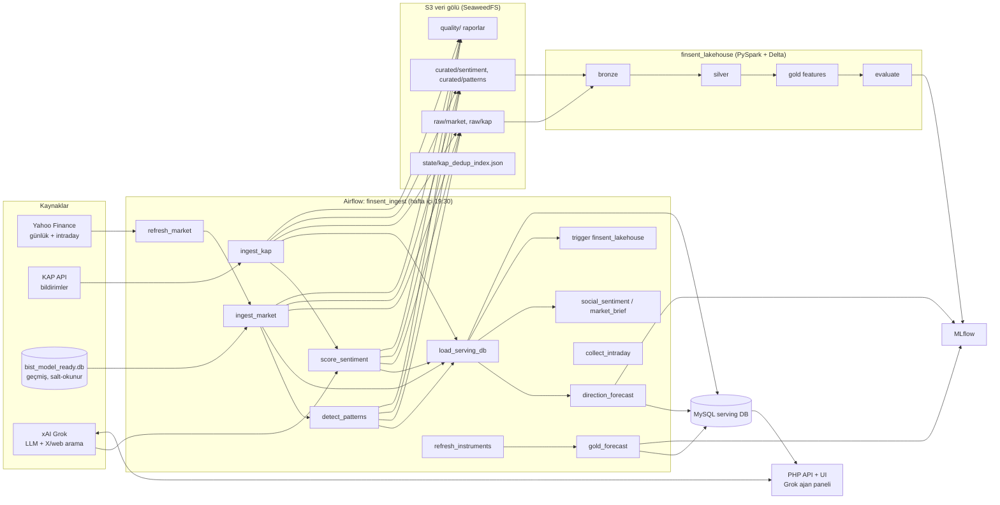

# FinSent: agent devir dosyası (handoff)

> Bu dosya, projeyi devralacak bir yapay zekâ ajanı ya da geliştirici için yazıldı. Projede ne var, neler yapıldı, neler denendi ve tutmadı, açık işler neler ve nelere dokunulmamalı, hepsi burada.
> Son güncelleme: 2026-11-08 (Jarvis entegrasyonu).
> Kavramların açıklamalı eğitim versiyonu [docs/EGITIM.md](docs/EGITIM.md) dosyasındadır.

---

## 1. Proje tek paragrafta

FinSent, Borsa İstanbul (BIST) hisseleri için bir **finansal duygu ve örüntü analizi platformudur**. Platform şunları yapar:

- **Veri toplama:** fiyat verisini Yahoo Finance'ten, şirket bildirimlerini KAP'tan (Kamuyu Aydınlatma Platformu) çeker.
- **Duygu puanlama:** bildirimleri xAI Grok LLM'iyle olumlu/olumsuz/nötr olarak puanlar.
- **Örüntü tespiti:** teknik örüntüleri yakalar (kırılım, hacim patlaması, RSI vb.).
- **Tahmin:** hisseler için kalibre edilmiş yön olasılıkları, altın için fiyat aralığı üretir.
- **Veri gölü ve hat:** her şeyi Airflow ile S3 veri gölüne (SeaweedFS, S3 uyumlu) ve Delta Lake katmanlarına (bronze/silver/gold, PySpark) taşır. ML deneylerini MLflow'a kaydeder.
- **Arayüz:** PHP + MySQL backend üzerinde koyu temalı bir arayüz sunar. İçinde sağda, araç kullanan bir **Grok ajan paneli**, çizim araçları ve alarmlar vardır.

Proje başlangıçta bir CV proje tanımından yola çıktı. Kullanıcı Türkçe konuşur, **yanıtlar Türkçe olmalıdır**.

---

## 2. Kesin kurallar (ihlal etmeyin)

| Kural | Neden |
|---|---|
| `finsent/.env` içindeki `XAI_API_KEY` **asla** yazdırılmaz, loglanmaz, commit edilmez. `.env` gitignore'dadır, şablon `.env.example`'dır. | Gerçek, ücretli anahtar |
| `../bist_model_ready.db` (repo dışında, üst klasörde) **değiştirilmez**. Uygulama artık birebir kopyasını kullanır: `data/market/bist_model_ready.db` (salt-okunur açılır, `finsent seed` ile de gelir). | Kullanıcının orijinal geçmiş veritabanı (≤ 2025-11-21) |
| KAP'a **dürüst User-Agent** ile gidilir: `finsent/1.0 (personal research project)`. Bot korumasını aşma ya da sahte UA yok. Rate-limit'e (429) uyulur. | Kullanıcı isteği ve etik |
| Grok harcaması kullanıcı tarafından onaylandı ("para sorun değil"), ama israf edilmez. | Toplu işlerde hızlı model kullanılır |
| Yön tahminleri dürüst raporlanır. AUC ≈ 0.5 ise "yazı-tura" denir. | Kullanıcı "53% yazı tura, güvenemem" dedi; şeffaflık istiyor |
| UI: siyah/koyu, **mavi ve mor yok**, rengârenk değil, ham JSON gösterilmez. | Kullanıcı tasarım isteği |

---

## 3. Çalıştırma

```bash
cd finsent
cp .env.example .env          # XAI_API_KEY girilir (anahtar yoksa lexicon'a düşer)
docker compose up -d --build
docker compose exec airflow finsent seed   # veri: GitHub Release data-* (~730 MB)
```

**Veri dağıtımı:**

- Veri, GitHub Releases'ta `data-YYYY-MM-DD` etiketiyle yayınlanır (`pipeline/finsent/snapshot.py`).
- Yeni snapshot için önce `finsent export-snapshot --out data/snapshot_release` (host'ta çalıştırılacaksa `MYSQL_PORT=3307` gerekir), sonra `gh release create data-… data/snapshot_release/*` çalıştırılır.
- `seed` MySQL tablolarını **TRUNCATE eder**. Kullanıcının canlı veritabanında, onayı olmadan çalıştırmayın.
- `alerts` ve `drawings` (kişisel) export edilmez.
- Fiyat verisinin yayınlanmasına kullanıcı karar verdi (Yahoo koşulları riski kendisine bildirildi).
- `backend/sql/schema.sql` içinde `USE finsent;` var. Başka bir veritabanına uygulamak için önce `sed` ile değiştirin.

| Servis | Adres | Not |
|---|---|---|
| Web arayüz + API | http://localhost:8080 | PHP 8.3 Apache. `backend/public` ve `backend/src` salt-okunur bind-mount edilir, değişiklik anında yansır |
| Airflow | http://localhost:8081 | admin / admin. `standalone` modu, LocalExecutor, metadata DB MySQL'de |
| MLflow | http://localhost:5000 | Deneyler: `finsent-forecast`, `finsent-forecast-research`, `finsent-gold-forecast`, sentiment benchmark |
| MySQL | localhost:3307 | DB `finsent`. Şifreler `.env` içinde |
| S3 (SeaweedFS) | http://localhost:8333 | Bucket `finsent-lake`, anahtarlar `finsent` / `finsent-dev-secret` (`infra/seaweedfs/s3.json`) |

**Bellek:** Docker Desktop (WSL2) ~8 GB. `mem_limit` değerleri: airflow 5g, mysql 1536m. Hisse tahmin modelinin yeniden eğitimi ~3 GB kullanır. Eskiden VM'i kilitliyordu, çözümü slim float32 frame ve joblib kaydıydı. VM kilitlenirse: `wsl --shutdown` ve Docker Desktop'ı yeniden başlatın.

**Testler:** `pipeline/.venv` içinde `python -m pytest pipeline/tests -q` çalıştırılır. 33 test var, hepsi geçiyor.

**Konteynere hızlı kod aktarımı:** airflow imajı `finsent` paketini site-packages'a kurar. İmajı yeniden derlemeden denemek için:

```bash
MSYS_NO_PATHCONV=1 docker compose cp pipeline/finsent/X.py airflow:/home/airflow/.local/lib/python3.11/site-packages/finsent/X.py
```

Kalıcı olması için `docker compose build airflow && docker compose up -d airflow` gerekir. **Şu an birkaç dosya docker cp ile atılmış durumda. Bir sonraki adımda imaj yeniden derlenmeli** (bkz. §10).

**Windows notu:** Git Bash'te `docker compose exec ... /tmp/x` yolları dönüştürülür. Önüne `MSYS_NO_PATHCONV=1` konur. İçinde `'''` olan uzun heredoc'lar Bash aracını bozabiliyor; dosyayı scratchpad'e yazıp çalıştırmak daha güvenli.

---

## 4. Mimari



### Klasörler

| Yol | İçerik |
|---|---|
| `docker-compose.yml` | mysql, s3 (SeaweedFS), mlflow, web, airflow |
| `pipeline/finsent/` | Python paketi: veri toplama, temizlik, duygu, örüntü, tahmin |
| `pipeline/tests/` | pytest (moto ile S3 mock'u) |
| `airflow/dags/` | `finsent_ingest.py` (günlük), `finsent_lakehouse.py` (tetiklenen Spark işi) |
| `airflow/Dockerfile` | Java 17, pyspark 3.5.3, delta-spark 3.2.1, yfinance, finsent paketi |
| `databricks/` | Spark/Delta kodu ve Databricks Asset Bundle (`databricks.yml`, job yml). Lokalde airflow içinde çalışır |
| `backend/` | PHP 8.3: `public/index.php` (router), `src/Controllers`, `src/Services`, `sql/schema.sql`, `public/assets` (SPA) |
| `scripts/` | Araştırma betikleri (tahmin laboratuvarı, çift analizi, altın laboratuvarı) |
| `docs/` | `forecast_research.md` (hisse tahmin araştırması), `EGITIM.md` (eğitim dokümanı) |
| `data/` | **Git'e girmez.** `market/bist_updates.db` (Yahoo güncellemeleri), `market/intraday.db`, `models/*.joblib`, `research/` (backfill logları, feature parquet) |

---

## 5. Python paketi (`pipeline/finsent`)

| Modül | Görev |
|---|---|
| `config.py` | `Settings`: tüm env değişkenleri. `market_source` varsayılanı `auto` = sqlite geçmiş + Yahoo güncellemeleri |
| `market.py` | `load_from_sqlite`, `load_from_updates`, `load_auto`, `compute_indicators` (SMA, RSI, hacim z-skoru vb.) |
| `market_refresh.py` | Yahoo → `data/market/bist_updates.db`. `symbol_universe()` |
| `kap.py` | Bildirim modeli, `content_hash(symbol, subject, summary, body, day)`, gürültü filtresi, `load_live` |
| `kap_live.py` | `KapLiveClient`: KAP API, dürüst UA, `KapRateLimited` (429 / Retry-After), `extract_body_text` (RSC payload temizliği), `NOISE_SUBJECTS` (varant, piyasa yapıcılığı vb.) |
| `dedup.py` | İki katmanlı tekilleştirme: KAP id'si ve gün-farkında içerik hash'i. Durum S3'te `state/kap_dedup_index.json` |
| `quality.py` | Veri kalitesi kontrolleri: null, OHLC tutarlılığı, tatil günleri (`BIST_HOLIDAYS` 2024–2026), fiyat sıçramaları. Raporlar S3 `quality/` ve MySQL `dq_reports` |
| `storage.py` | `Lake`: boto3 S3 parquet okuma/yazma. Şemalar pyarrow ile sabitlenmiş |
| `jobs.py` | DAG görevlerinin gövdeleri: `ingest_market`, `ingest_disclosures`, `score_sentiment`, `detect_patterns`, `load_serving_db` (hash çakışma koruması), `refresh_market`, `social_sentiment`, `market_brief` |
| `mysql_sink.py` | Toplu upsert (`INSERT … ON DUPLICATE KEY UPDATE`). numpy tip temizliği |
| `patterns.py` | Örüntü dedektörleri ve `event_returns` (olay sonrası 1/5/20 gün getirisi) |
| `sentiment/` | `schema.py` (yapılandırılmış çıktı şeması), `lexicon.py` (Türkçe sözlük tabanlı yedek), `llm.py` (Claude, anahtar yok, kullanılmıyor), `grok.py` (GrokClient + GrokAnalyzer), `__init__.py` (`active_provider`: anthropic → xai → lexicon) |
| `forecast.py` | Hisse yön modeli v2 (bkz. §7) |
| `gold_forecast.py` | Altın aralık modeli (bkz. §8) |
| `instruments.py` | XAUUSD, XAGUSD, USDTRY, EURTRY, XU100. Türetilmiş ALTIN/GUMUS = ons × USDTRY ÷ 31,1035. `market_daily`'ye `source='instrument'` olarak yazılır |
| `intraday.py` | 1m/5m/15m çubuklar → `data/market/intraday.db` |
| `rescore.py` | xai skoru olmayan tüm geçmiş bildirimleri toplu Grok ile puanlar |
| `lake_rebuild.py` | S3 gölünü MySQL + fiyat kaynaklarından aynı düzen ve şemayla yeniden yazar (`finsent rebuild-lake`) |
| `snapshot.py` | `export-snapshot` (tablo başına Parquet, şema MySQL tiplerinden; gz SQLite; modeller; sha256 manifest) ve `seed` (release indir, doğrula, yükle, gölü kur) |
| `cli.py` | `finsent run`, `analyze`, `patterns`, `reset-disclosures`, `rebuild-lake`, `export-snapshot`, `seed`, `backfill-kap` (`--retry-from-log`, 429'da 300 sn bekleme, 4 deneme, 6 sn aralık) |

### Grok kullanımı (`sentiment/grok.py`)

- **Uç noktalar:** `chat/completions` ile `response_format: json_schema` (strict) ve `/v1/responses` ile `x_search`, `web_search`, function tools, `previous_response_id`.
  - **Dikkat:** `instructions` ile `previous_response_id` aynı istekte gönderilemez; instructions yalnızca ilk istekte gider.
- **Modeller:** `grok-4.7` arama, ajan ve içgörüler için; `grok-4.20-0309-non-reasoning` toplu puanlama için.
- **Maliyet:** `usage.cost_in_usd_ticks / 1e10` USD.
- **Toplu puanlama:** `analyze_batch` 40 bildirimi tek istekte puanlar; tekli puanlamayla 37/40 uyum ölçüldü. `FINSENT_LLM_WORKERS=8` paralel çalışır, hız ~18–75 öğe/sn.

---

## 6. Veri durumu (2026-11-08)

| Tablo | Kayıt | Aralık |
|---|---|---|
| `market_daily` | 2.359.058 | 1996-12-27 → 2026-11-07. 642 sembol (hisseler + enstrümanlar) |
| `disclosures` | 254.119 | 2021-01-04 → 2026-11-06. Geçmiş backfill tamamlandı, boşluk taraması temiz (yalnızca bayram arifeleri düşük) |
| `disclosure_sentiment` | xai: tüm bildirimler + lexicon | `v_sentiment` görünümü lexicon dışı sağlayıcıyı tercih eder |

Diğer tablolar: `companies`, `event_returns`, `patterns`, `llm_insights`, `pipeline_runs`, `dq_reports`, `model_evaluations`, `social_sentiment`, `market_briefs`, `forecasts`, `research_results`, `alerts`, `drawings`. Şema: `backend/sql/schema.sql`.

---

## 7. Hisse yön tahmini (forecast v2)

Ayrıntılar `docs/forecast_research.md` dosyasında.

- **Model:** `HistGradientBoostingClassifier`. Parametreler: `max_iter` 200, `learning_rate` 0.03, 15 yaprak, `min_samples_leaf` 3000, L2 5.
- **Kalibrasyon:** önceki yıla isotonic kalibrasyon.
- **Hedefler:** mutlak yön (yukarı/aşağı) ve BIST 100'ü geçme. Ufuklar 1/5/20 gün.
- **Özellikler:** ~40 genişletilmiş özellik ve bunların günlük kesitsel yüzdelikleri. Momentum, kısa vadeli dönüş, likidite, büyüklük, beta, artık momentum, piyasa rejimi, USD/TRY.
- **Değerlendirme:** yıllık walk-forward (2022, 2023, 2024, 2025–26), 1,5 × ufuk boşlukla.
- **Sonuçlar:**
  - mutlak AUC .554 / .560 / .565;
  - endeksi geçme sıralama IC ≈ 0.10;
  - en iyi %10'luk dilimin %51'i endeksi geçiyor, en kötü %10'luk dilimin %37'si (taban oran %44).
- **Analog yöntemi ölçüldü, beceri yok:** AUC ≈ taban oran. Yalnızca bağlam olarak gösterilir.
- **Üretim:**
  - `forecast.run()` haftada bir yeniden eğitir (`retrain_after_days=7`), diğer günler `data/models/forecast_v2.joblib` ile yalnızca tahmin yapar;
  - son 365 gün holdout'u MLflow `finsent-forecast` deneyine yazılır;
  - `forecasts` tablosuna payload `version: "v2"` olarak kaydedilir.
- **KAP haber özellikleri test edildi, eklenmedi.** `scripts/forecast_news_lab.py` sonuçlarına göre AUC ve IC farkı ±0,001. Olay çalışması: `scripts/news_event_study.py`.

## 8. Altın tahmini (`gold_forecast.py`, payload `gold-v1`)

- **Semboller:** XAUUSD (2001+) ve ALTIN (2006+).
- **Özellikler (28):** altın getirileri, RSI, SMA uzaklıkları, oynaklık; DXY, US10Y, VIX, petrol, S&P 500, bakır, altın/gümüş oranı; gram altın için USD/TRY.
- **Araştırma bulgusu** (her yıl 2012–2026, yalnızca önceki veriyle eğitilmiş modelle test):
  - **Yön tahmin edilemiyor.** Logit, GBM ve ortalamaları AUC 0,48–0,53 aldı. İsabet "hep yukarı" demekten düşük.
  - **Hiçbir zamanlama kuralı al-tut stratejisini geçemedi.** Gram altın al-tut yıllık +%32,9.
  - **Oynaklık tahmin edilebiliyor.** %90 bant gerçekleşenlerin %88–90'ını, %68 bant %65–70'ini kapsadı.
- **Üretim yöntemi:**
  - log-oynaklık regresyonu (5/20/60 g oynaklık + VIX);
  - son 10 yılın ölçeklenmiş getiri dağılımının ampirik kantilleri;
  - sonuç: p05/p16/p50/p84/p95 fiyat bantları (1/5/20 gün), makro tablo, kural backtestleri, yön çalışması.
- **DAG görevi:** `gold_forecast`, `refresh_instruments`'tan sonra çalışır. Her gün yeniden fit eder, haftada bir araştırmayı tekrarlar (`data/models/gold_study.json`).
- **UI:** altın sayfasındaki "Sırada ne olabilir?" kartı. Buton bantları grafiğe çizer.
- **Ajan:** `get_forecast` altın için yön iddiası yapmaz.

## 9. Diğer araştırmalar

- **PGSUS–THYAO ilişkisi:**
  - Engle-Granger eşbütünleşme ve Granger nedensellik testleri yapıldı (`scripts/pairs_analysis.py`, `pairs_backtest.py`); sonuçlar `research_results` tablosunda.
  - Günlük çift ticareti: örneklem dışında yılda +%2,4. Değiştirme stratejisi THYAO'yu tutmaktan kötü.
  - 5 dakikalık "yetişme" stratejisi: işlem başı brüt +%0,17, konfigürasyonların %98'i pozitif. Ancak IS–OOS sıra korelasyonu −0,32, başabaş maliyeti işlem başı ~8 bp.
  - Kullanıcının aracı kurumu Midas komisyonsuz ama API'si yok; otomatikleştirilemez.
- **Altın analizi:**
  - BIST 100 2005'te ~25 gram altın ediyordu, bugün 1,75 gram.
  - Son 1 yılda gram altın +%21,6, BIST altın bazında −%14,7.
  - Altın ile USD/TRY korelasyonu ≈ 0.

---

## 10. Açık işler (sıralı)

Tamamlananlar (2026-11-08):

- KAP geçmiş backfill'i bitti: 122 pencere, 193.499 yeni bildirim. Tek hata veren gün (2021-01-01) boş DataFrame'de `.dt` hatasıydı; `jobs.py` düzeltildi ve gün yeniden çekildi.
- Rescore bitti: tüm bildirimler (~252 bin, 2021-01-04 → bugün) Grok skorlu.
- Airflow imajı yeniden derlendi; docker cp ile atılan dosyalar artık imajda.
- Haber özellikli tahmin A/B testi yapıldı: **iyileştirme yok**, haber özellikleri eklenmedi. Olay çalışması yapıldı (`docs/forecast_research.md` → "KAP news"). Bulgu: olumlu haber aynı gün fiyatlanıyor; olumsuz haberde 20 günde −%0,5'lik gecikmeli tepki var.
- **S3 deposu LocalStack'ten SeaweedFS'e taşındı.** LocalStack community S3'ü bellekte tutuyordu; Docker yeniden başlayınca veri gölü silinmişti ve lakehouse `PATH_NOT_FOUND` veriyordu. Docker Hub'da MinIO imajı artık yok, bu yüzden SeaweedFS seçildi (`chrislusf/seaweedfs:3.97`, kalıcı `s3-data` volume'u, kimlik bilgileri `infra/seaweedfs/s3.json`). boto3 path-style adreslemeye geçirildi (`storage.py`).
- **Eylül 2026 boşluğu dolduruldu.** 7 Eylül – 2 Ekim 2026 arasında günde ~20 bildirim vardı. Eski S3 dedup indeksi, MySQL'de olmayan bildirimleri "görüldü" saymıştı. İndeks MySQL'den yeniden kurulunca aralık yeniden çekildi: +2.169 bildirim, hepsi Grok skorlu. Boşluk kontrolü için iş günü başına sayı, 41 günlük medyanın %40'ının altında mı diye bakıldı.
- **Göl MySQL'den yeniden kuruldu.** Komut: `finsent rebuild-lake --start 2021-01-01 --end 2026-11-07` (`lake_rebuild.py`). Sonuç: 1.462 fiyat bölümü, 251.950 bildirim, 499.405 duygu satırı, 319.505 örüntü ve dedup indeksi. Bunun için `quality.BIST_HOLIDAYS`'e 2021–2023 tatilleri ve 8–14 Şubat 2023 deprem kapanışı eklendi.
- Lakehouse DAG yeniden kurulan gölle tekrar çalıştırıldı (run id `lakehouse_after_s3_rebuild`).

- **Jarvis entegrasyonu (2026-11-08):** `pipeline/finsent/jarvis_push.py` + `finsent jarvis-push` komutu. Günlük DAG'ın sonunda `jarvis_push` görevi (`trigger_rule=all_done`; tahmin, altın, sosyal duygu ve brief'ten sonra) çalışır. Bu görev, kullanıcının bulutta çalışan sesli asistanı Jarvis'e (ayrı repo `AliEmreArar/jarvis`, Cloudflare Worker) özet veri yükler. Genel özet (`/finsent/snapshot`, ~14 KB) piyasa, enstrümanlar, genişlik, en çok yükselen/düşenler, brief, altın aralıkları, önemli KAP bildirimleri ve 5 günlük model sıralamasını içerir. Hisse başına satırlar (`/finsent/stocks`, 100'lük parçalar, ~628 hisse) fiyat, teknikler, tahmin olasılıkları, X duygu analizi ve son KAP bildirimlerini içerir. `.env` içinde `JARVIS_URL` / `JARVIS_TOKEN` yoksa görev atlanır (token gizlidir, yazdırılmaz). Airflow imajı bu modülle yeniden derlendi.

Açık kalanlar:

1. **Test alarmı:** id 2 (THYAO fiyat > 310) hâlâ aktif. Kullanıcıya söylendi.
2. Fikir havuzundan kullanıcının seçeceği iş.

### Fikir havuzu (yapılmadı)

- **Olumsuz KAP bildirimi uyarı rozeti:** hisse sayfasında ve ajan bağlamında gösterilir. Olay çalışmasına göre olumsuz haber sonrası 20 günde endeksin ~%0,5 altında kalınıyor.

- Gümüş (XAGUSD/GUMUS) için de aralık modeli.
- Hisseler için de oynaklık ve aralık bantları (altında kalibre çıktı; hisselerde de büyük ihtimalle işe yarar).
- KAP bildirim türüne göre olay çalışması (temettü, bedelsiz, ihale vb.) ve bunların tahmine eklenmesi.
- Ons altın grafiğinde fiyat ekseni 3 ondalık gösteriyor (`4.033,600`); 2 ondalığa düşürülebilir.

---

## 11. Arayüz ve ajan

- **SPA:** `backend/public/app.html` ve `assets/app.js` (hash yönlendirme, sayfalar aşağıda), `assets/app.css`, `assets/agent.js` (ajan paneli), `assets/draw.js` (çizim motoru).
- **Sayfalar:**
  - `#/piyasa`: genel görünüm ve enstrüman kutucukları;
  - `#/hisse/SYM`: grafik, tahmin, KAP, sinyaller;
  - `#/cift`: çift analizi;
  - `#/bildirimler`: haber akışı ve etki;
  - `#/sinyaller`;
  - `#/analiz`: serbest metin analizi;
  - `#/sistem`: pipeline sağlığı ve veri kalitesi.
- **Grafik:** TradingView Lightweight Charts v4.2. Atıf linki zorunlu, kaldırılmasın. Mumlar 15dk/1S/4S/G/H/A, para birimi ₺/$.
- **Renk paleti** (dataviz validator ile doğrulandı):
  - yükseliş `#35ad6e`, düşüş `#c2413b`;
  - vurgu `#bf8a2e` (metin `#dcae57`);
  - yüzey `#141416`.
- **Çizim araçları:** trend, yatay, kanal, fib, dikdörtgen. Çizimler `drawings` tablosunda tutulur (zaman naive-UTC ms + fiyat).
- **Ajan** (`AgentController.php` + `Services/AgentTools.php`):
  - NDJSON akışı, en fazla 8 adım, `grok-4.7`.
  - **Araçlar:** fiyat geçmişi, göstergeler, destek/direnç, örüntüler, KAP, haber etkisi çalışması, tahmin, sosyal duygu, karşılaştırma, tarama, strateji backtesti, piyasa özeti, `chart_actions` (grafiğe çizer), `get_user_drawings`, alarm oluşturma/listeleme/silme, `web_search`, `x_search`.
  - **Görsel girdi:** grafik ekran görüntüsü ve kullanıcı çizimlerinin birleşimi.
  - Kullanıcının çizimleri sayısal anlamlarıyla bağlama eklenir.

---

## 12. Bilinen tuzaklar (yaşandı, çözüldü)

- **Parquet şema uyuşmazlığı:** null tipli `key_points` ve INT32 `market_cap_try` sorun çıkardı. Çözüm: pyarrow şemaları sabitlendi.
- **Sızıntı:** gold katmanında aynı gün teknik özellikler AUC'yi 0,68'e şişiriyordu. Özellikler bir gün geciktirilince AUC 0,58'e indi.
- **content_hash çakışması:** rutin günlük bildirimlerde FK hatası çıkıyordu. Çözüm: hash'e gün eklendi ve `load_serving_db`'ye çakışma koruması kondu.
- **S3 verisi kayboldu:** LocalStack community kalıcı değil. SeaweedFS'e geçildi. Göl kaybolursa `finsent rebuild-lake` kullanılır; doğruluk kaynağı MySQL'dir.
- **Gürültü bildirimleri:** raw'dan tekrar giriyordu. Çözüm: `_read_raw_disclosures` ve `extract_disclosures` içinde filtre.
- **KAP gövde metni:** RSC payload içeriyordu. Regex ile temizlendi, 702 satır düzeltildi.
- **USD dönüşümü:** döngü değişkeni çakışması vardı; ayrıca yavaştı (6,5 sn). Şimdi kur, sembolün kendi satırlarından okunuyor.
- **Breadth hesabı:** cumartesi EURTRY satırları yüzünden boş dönüyordu. `MAX(trade_date)` artık enstrümanları hariç tutuyor.
- **PHP ve MySQL:** tek tırnaklı PHP içinde MySQL `"instrument"` literal'i çift tırnakla yazılır.
- **Hızlı sayfa geçişi:** null element hataları veriyordu. Çözüm: `$()` bulamazsa ayrık bir div döndürür.
