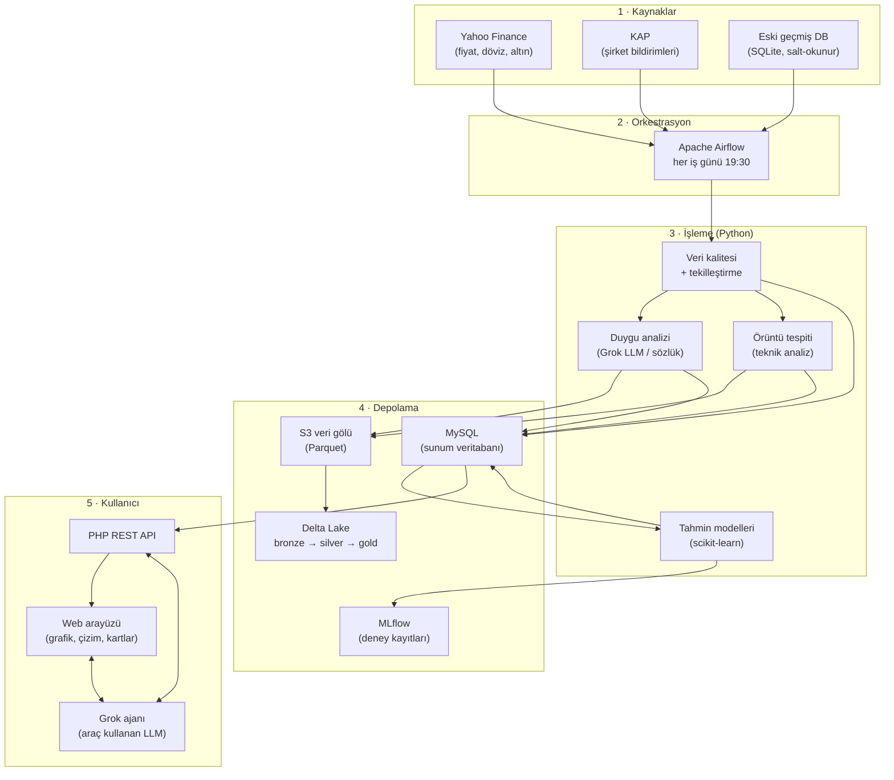
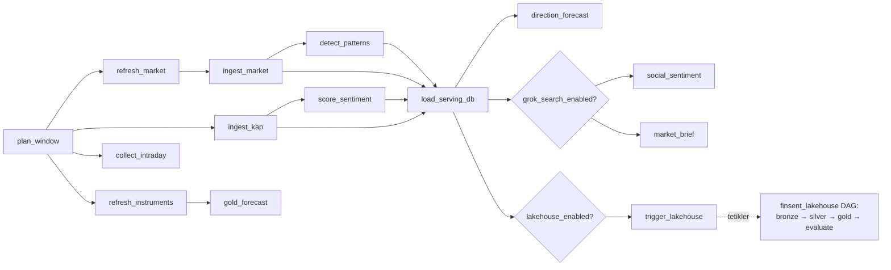
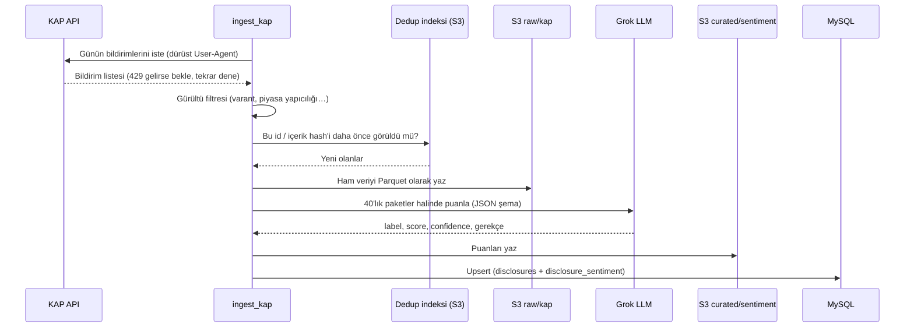
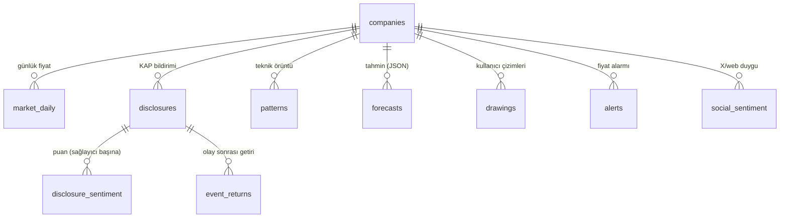
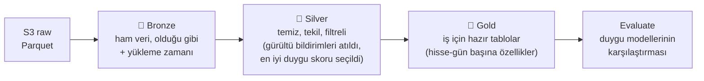
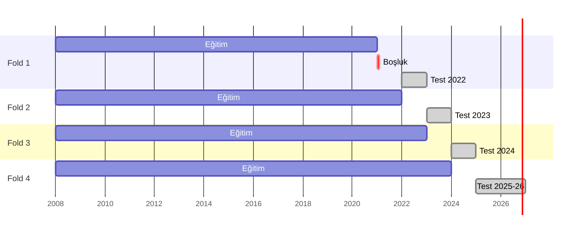
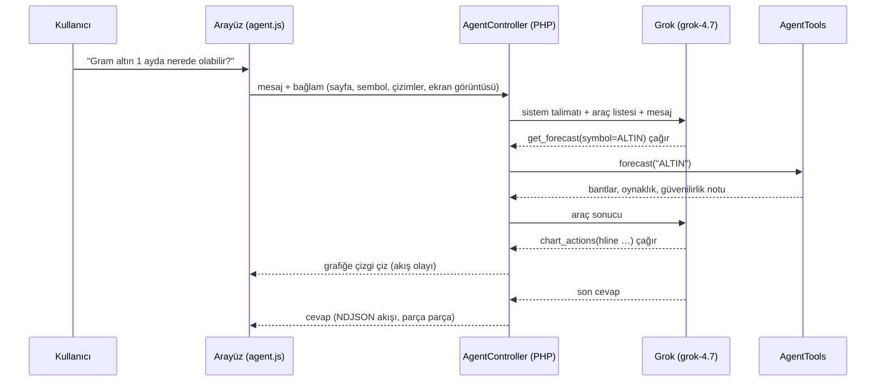

# FinSent eğitim rehberi: projedeki teknolojiler, ne işe yaradıkları ve nasıl kullandığımız

Bu doküman, FinSent'i inceleyerek veri mühendisliği, makine öğrenmesi, LLM ve web geliştirme konularında kendini geliştirmek isteyen biri için yazıldı. Her başlıkta aynı yapı var:

- **Nedir?**: kavramın kısa ve sade tanımı.
- **Neden kullandık?**: projede hangi sorunu çözüyor.
- **Nasıl kullandık?**: kodda nerede ve nasıl. Dosya yolları verildi, açıp bakabilirsin.
- 💡 **Öğrenme notu**: dikkat edilmesi gereken incelikler.

Diyagramlar GitHub'da otomatik çizilir (Mermaid formatı).

---

## İçindekiler

1. [Büyük resim: proje ne yapıyor?](#1-büyük-resim-proje-ne-yapıyor)
2. [Mimari şemalar](#2-mimari-şemalar)
3. [Altyapı: Docker ve Docker Compose](#3-altyapı-docker-ve-docker-compose)
4. [Veri kaynakları: Yahoo Finance, KAP, xAI Grok](#4-veri-kaynakları)
5. [Veri gölü: S3, LocalStack, Parquet](#5-veri-gölü-s3-localstack-parquet)
6. [Orkestrasyon: Apache Airflow](#6-orkestrasyon-apache-airflow)
7. [Veri kalitesi ve tekilleştirme](#7-veri-kalitesi-ve-tekilleştirme)
8. [Büyük veri: Spark, Delta Lake, Medallion, Databricks](#8-büyük-veri-spark-delta-lake-medallion-databricks)
9. [Duygu analizi: sözlük, LLM, yapılandırılmış çıktı](#9-duygu-analizi)
10. [Teknik analiz ve örüntüler](#10-teknik-analiz-ve-örüntüler)
11. [Makine öğrenmesi ile tahmin](#11-makine-öğrenmesi-ile-tahmin)
12. [MLflow: deney takibi](#12-mlflow-deney-takibi)
13. [Altın modeli: yön mü, aralık mı?](#13-altın-modeli-yön-mü-aralık-mı)
14. [Çift analizi: eşbütünleşme ve backtest](#14-çift-analizi-pgsus--thyao)
15. [Backend: PHP, REST API, MySQL](#15-backend-php-rest-api-mysql)
16. [Frontend: SPA, grafikler, çizim motoru](#16-frontend-spa-grafikler-çizim-motoru)
17. [Agentic yapı: araç kullanan LLM](#17-agentic-yapı-araç-kullanan-llm)
18. [Güvenlik ve iyi pratikler](#18-güvenlik-ve-iyi-pratikler)
19. [Test](#19-test)
20. [Önerilen çalışma planı ve alıştırmalar](#20-önerilen-çalışma-planı-ve-alıştırmalar)
21. [Sözlük](#21-sözlük)

---

## 1. Büyük resim: proje ne yapıyor?

Borsa İstanbul hisseleri için üç soruya cevap arıyoruz:

1. **Ne oldu?** Fiyatlar nasıl hareket etti, şirketler KAP'a hangi bildirimleri yaptı?
2. **Bu ne anlama geliyor?** Bildirim olumlu mu olumsuz mu, grafikte hangi örüntüler var, geçmişte benzer olaylardan sonra ne oldu?
3. **Sırada ne olabilir?** Önümüzdeki 1 gün, 1 hafta ve 1 ay için olasılıklar ve aralıklar.

Bunun için bir **veri hattı (data pipeline)** kurduk. Hat veriyi toplar, temizler, zenginleştirir (duygu, örüntü), saklar (veri gölü ve veritabanı), modelleri eğitir ve sonuçları arayüze taşır. Arayüzde ayrıca soruları cevaplayan ve araç kullanan bir **yapay zekâ ajanı** var.

> 💡 **Öğrenme notu:** Gerçek dünyada projelerin çoğu "model" kısmından değil, **veri** kısmından zorlanır. Bu projede de zamanın büyük kısmı veriyi doğru, tekil, temiz ve sızıntısız hâle getirmeye gitti.

---

## 2. Mimari şemalar

### 2.1 Genel mimari



### 2.2 Günlük DAG (Airflow iş akışı)

Okların anlamı: "önce bu bitmeli, sonra şu başlar".



### 2.3 Bir KAP bildiriminin yolculuğu



### 2.4 Veritabanı ilişkileri (sadeleştirilmiş)



---

## 3. Altyapı: Docker ve Docker Compose

**Nedir?** Docker bir uygulamayı ve tüm bağımlılıklarını (Python sürümü, kütüphaneler, Java…) **konteyner** denen izole bir kutuya koyar. Böylece "benim bilgisayarımda çalışıyordu" sorunu ortadan kalkar. **Docker Compose** ise birden fazla konteyneri tek bir YAML dosyasıyla tanımlayıp birlikte başlatmaya yarar.

**Neden kullandık?** Projede 5 ayrı servis var: MySQL, S3 taklidi, MLflow, PHP web sunucusu ve Airflow (içinde Spark). Bunları elle kurmak saatler sürer. Compose ile tek komut yetiyor: `docker compose up -d`.

**Nasıl kullandık?** `docker-compose.yml` dosyasında şunlar tanımlı:

| Kavram | Projedeki örnek |
|---|---|
| `image` | `mysql:8.0`, `localstack/localstack:3.8`. Hazır imajlar kullanılıyor |
| `build` | `airflow/Dockerfile`, `backend/Dockerfile`. Kendi imajlarımızı derliyoruz |
| `ports` | `"8080:80"`: bilgisayarın 8080 portu, konteynerin 80 portuna gider |
| `volumes` | `./data:/opt/finsent/data` klasör paylaşımı. `:ro` salt-okunur demek; orijinal DB böyle bağlandı ki yanlışlıkla bozulmasın |
| `environment` / `.env` | Şifreler ve API anahtarları koda değil ortam değişkenine konur |
| `mem_limit` | Airflow'a 5 GB sınırı. Model eğitimi bir kez tüm sanal makineyi kilitlemişti |
| `healthcheck` / `depends_on` | MySQL hazır olmadan Airflow başlamasın |

> 💡 **Öğrenme notu:** Konteynerin içindeki dosyalar konteyner silinince kaybolur. Kalıcı olması gereken veri (MySQL verisi, `data/` klasörü) **volume** ile dışarı bağlanır.

---

## 4. Veri kaynakları

### 4.1 Yahoo Finance (`yfinance`)

- **Ne?** Ücretsiz, yaklaşık 15 dakika gecikmeli fiyat verisi. BIST hisseleri `THYAO.IS` gibi sembollerle gelir.
- **Nasıl?** `pipeline/finsent/market_refresh.py` günlük çubukları (açılış, yüksek, düşük, kapanış, hacim; kısaca OHLCV) çeker. `intraday.py` 1, 5 ve 15 dakikalık çubukları çeker. `instruments.py` altın (`GC=F`), dolar (`USDTRY=X`), BIST 100 (`XU100.IS`) gibi enstrümanları çeker.
- **Sınırlar:** 1 dakikalık veri son 7 günü, 5 ve 15 dakikalık veri son 60 günü kapsar. Saatlik veri ~3 yıl geriye gider.
- **Gram altın** borsada işlem görmez; biz hesaplıyoruz: `ons fiyatı × USD/TRY ÷ 31,1035`. 1 ons 31,1035 gramdır.

### 4.2 KAP (Kamuyu Aydınlatma Platformu)

- **Ne?** Şirketlerin yasal bildirimlerini yaptığı resmi platform: bilanço, temettü, ihale, yönetim değişikliği vb.
- **Nasıl?** `kap_live.py` içindeki `KapLiveClient` KAP'ın sitesinin kullandığı JSON uçlarını çağırır.
- **Etik ve teknik kurallar:**
  - **Dürüst User-Agent.** Kendimizi tarayıcı gibi göstermiyoruz.
  - **Rate limit.** Site "çok hızlısın" derse (HTTP 429), `Retry-After` kadar bekleyip tekrar deniyoruz (`KapRateLimited`). Geçmiş veri çekerken istekler arasında 6 saniye bekliyoruz.
  - **Gürültü filtresi.** Günde yüzlerce "varant", "piyasa yapıcılığı" bildirimi analiz için anlamsız; ayıklanıyor (`NOISE_SUBJECTS`).
- **Backfill:** geçmiş verinin toplu doldurulması. `finsent backfill-kap` komutu geriye doğru gün gün iner, hata alan günleri loga yazar, `--retry-from-log` ile sonra tekrar dener.

### 4.3 xAI Grok

- **Ne?** xAI şirketinin büyük dil modeli (LLM). OpenAI uyumlu bir HTTP API sunar ve **X (Twitter) ile web'de arama** yapabilir.
- **Neden?** Kullanıcının Grok anahtarı var. Hem bildirim metinlerini anlamak (duygu) hem X'teki yatırımcı konuşmalarını özetlemek hem de ajan için kullandık.
- **Hangi model, neden?**
  - Ucuz ve hızlı model (`grok-4.20-…-non-reasoning`): yüz binlerce bildirimi toplu puanlamak için.
  - Güçlü model (`grok-4.7`): arama, ajan ve özet için.

> 💡 **Öğrenme notu:** "Her işe en güçlü model" yerine **işe göre model** seçmek, maliyeti 10 kat düşürebilir. Toplu işte hızlı modelin tekli puanlamayla %92 (37/40) uyumlu olduğunu ölçtük; tahmin etmedik.

---

## 5. Veri gölü: S3, LocalStack, Parquet

**Veri gölü (data lake) nedir?** Ham ve işlenmiş verinin, ucuz bir nesne deposunda (genelde Amazon S3) **dosya olarak** saklandığı yer. Veritabanından farkı: şema esnek, maliyet düşük, Spark gibi araçlar doğrudan okuyabilir.

**LocalStack** AWS servislerini bilgisayarında taklit eder. Gerçek AWS hesabı açmadan, para ödemeden S3 kodu yazıp test edebiliriz. Kod gerçek S3'te de aynen çalışır; sadece `endpoint_url` değişir.

**Klasör düzeni (bucket `finsent-lake`):**

| Önek | İçerik |
|---|---|
| `raw/market/`, `raw/kap/` | Kaynaktan geldiği gibi ham veri |
| `curated/sentiment/`, `curated/patterns/` | İşlenmiş, zenginleştirilmiş veri |
| `quality/` | Her çalışmanın veri kalitesi raporu |
| `state/kap_dedup_index.json` | Daha önce görülen bildirimlerin indeksi |

**Parquet nedir?** **Sütun bazlı** sıkıştırılmış dosya formatı. CSV'ye göre 5–10 kat küçük ve çok daha hızlıdır. "Sadece kapanış sütununu oku" denince diğer sütunlara hiç dokunmaz. Tipleri (tarih, sayı, metin) de saklar.

**Nasıl?** `storage.py` içindeki `Lake` sınıfı `boto3` ile S3'e Parquet yazar. Şemalar `pyarrow` ile **sabitlendi**.

> 💡 **Öğrenme notu (yaşanmış hata):** Bir gün bir sütun tamamen boş geldiği için Parquet onu "null" tipiyle yazdı. Ertesi gün dolu geldi, Spark iki dosyayı birleştiremedi. Çözüm: şemayı açıkça tanımlamak (`MARKET_SCHEMA`, `SENTIMENT_SCHEMA`). **Şemayı veriye bırakma, sen belirle.**

---

## 6. Orkestrasyon: Apache Airflow

**Nedir?** İş akışlarını (hangi adım ne zaman, hangi sırayla, hata olursa ne yapılacak) Python koduyla tanımlamaya yarayan zamanlayıcı. Bir iş akışına **DAG** (Directed Acyclic Graph, yönlü döngüsüz çizge) denir. Her kutu bir **task** (görev).

**Neden?** Her iş günü akşam şu adımlar sırayla çalışmalı: fiyatları çek, KAP'ı çek, puanla, örüntüleri bul, veritabanına yükle, tahmin üret. Bir adım hata verirse tekrar denenmeli, olanlar kayıt altına alınmalı.

**Projedeki kavramlar (`airflow/dags/finsent_ingest.py`):**

| Kavram | Açıklama | Örnek |
|---|---|---|
| `schedule` | Cron ifadesiyle zamanlama | `"30 19 * * 1-5"`: hafta içi 19:30 |
| `@task` | Python fonksiyonunu göreve çevirir (TaskFlow API) | `def ingest_kap(win)` |
| XCom | Görevler arası küçük veri aktarımı | `plan_window`'un döndürdüğü tarih aralığı |
| `retries` | Hata olursa kaç kez tekrar denensin | `@task(retries=2)` |
| `execution_timeout` | Görev en fazla ne kadar sürsün | tahmin için 1 saat |
| `short_circuit` | Koşul sağlanmazsa sonraki adımları atla | Grok anahtarı yoksa sosyal analiz atlanır |
| `TriggerDagRunOperator` | Başka bir DAG'ı tetikle | ingest bitince lakehouse DAG'ı çalışır |
| Backfill | Geçmiş tarihler için DAG'ı çalıştırmak | Tahmin görevleri geçmiş pencerede kendini atlar |

> 💡 **Öğrenme notu: idempotency (tekrar çalıştırılabilirlik).** Bir görevi aynı tarih için iki kez çalıştırmak aynı sonucu vermeli, veriyi ikiye katlamamalı. Bunun için veritabanına `INSERT … ON DUPLICATE KEY UPDATE` (upsert) ile, Delta'ya `MERGE` ile yazıyoruz. Pipeline'ların temel kuralı budur.

---

## 7. Veri kalitesi ve tekilleştirme

### 7.1 Veri kalitesi kontrolleri (`quality.py`)

Hatalı veri, hatalı modele yol açar. Her çalışmada şunlar kontrol edilir:

- **Tamlık:** zorunlu alanlarda boş değer var mı?
- **Tutarlılık:** yüksek ≥ düşük mü, kapanış bu aralıkta mı, hacim negatif mi?
- **Takvim:** tatil günü (`BIST_HOLIDAYS`) veya hafta sonu fiyat verisi var mı?
- **Aykırı değerler:** bir günde %25'ten fazla hareket var mı? Genelde bölünme ya da bedelsiz sermaye artırımıdır; gerçek hareket değildir.

Sonuçlar S3'e (`quality/`) ve MySQL `dq_reports` tablosuna yazılır, arayüzdeki **Sistem** sayfasında görünür.

### 7.2 Tekilleştirme (`dedup.py`)

Aynı bildirim farklı yollardan iki kez gelebilir. İki katmanlı kontrol yapıyoruz:

1. **Kimlik (id):** KAP'ın verdiği bildirim numarası.
2. **İçerik hash'i:** `sha256(sembol + konu + özet + gövde + gün)`. Hash, metni sabit uzunlukta bir parmak izine çevirir; aynı metin her zaman aynı izi verir.

> 💡 **Öğrenme notu (yaşanmış hata):** İlk sürümde hash'te **gün** yoktu. Her gün aynı metinle yapılan rutin bildirimler (ör. "günlük fon fiyatı") farklı günlerde aynı hash'i aldı ve veritabanında yabancı anahtar hatası çıktı. Çözüm: hash'e günü eklemek. Tekilleştirme anahtarını seçerken "aslında farklı olan ama aynı görünen" durumları düşün.

---

## 8. Büyük veri: Spark, Delta Lake, Medallion, Databricks

### 8.1 Apache Spark / PySpark

**Nedir?** Veriyi birçok bilgisayara (ya da çekirdeğe) bölüp paralel işleyen motor. PySpark onun Python arayüzüdür. pandas tek makinenin belleğiyle sınırlıdır, Spark değildir.

**Nasıl?** `databricks/src/finsent_lakehouse/` altındaki işler S3'teki Parquet'leri okur, birleştirir, özellik üretir. Lokalde Airflow konteynerinin içinde çalışır (Java 17 + pyspark 3.5.3).

### 8.2 Delta Lake

**Nedir?** Parquet dosyalarının üzerine bir **işlem günlüğü (transaction log)** ekleyen format. Kazandırdıkları:

- **ACID işlemler:** yazma yarıda kalırsa tablo bozulmaz.
- **MERGE (upsert):** "varsa güncelle, yoksa ekle". `spark.py` içindeki `merge_into` bunu yapar.
- **Time travel:** tablonun dünkü hâline bakabilirsin.
- **Şema kontrolü:** yanlış tipte veri yazılmasını engeller.

### 8.3 Medallion mimarisi (bronze → silver → gold)



- **bronze.py:** ham veriyi değiştirmeden Delta'ya alır. Hata olursa geri dönülecek kaynak budur.
- **silver.py:** temizler, `NOISE_SUBJECTS` ile filtreler, aynı bildirim için LLM puanını sözlük puanına tercih eder.
- **features.py:** hisse-gün başına duygu ortalamaları, bildirim sayıları ve teknik özellikler üretir.
- **evaluate.py:** sözlük, Claude ve Grok duygu puanlarını etiketli örneklerle ve sonraki getirilerle karşılaştırır.

> 💡 **Öğrenme notu (yaşanmış hata, çok önemli): veri sızıntısı (data leakage).** Gold tabloda teknik özellikler aynı günün kapanışıyla hesaplanıyordu, hedef de o günden sonraki getiriydi. Model AUC 0,68 gibi muhteşem bir skor verdi. Özellikleri **bir gün geciktirince** 0,58'e düştü. Gerçek olan 0,58'di. **Çok iyi görünen sonuç, önce sızıntı şüphesiyle incelenmeli.**

### 8.4 Databricks

**Nedir?** Spark ve Delta'nın yönetilen bulut platformu. `databricks/databricks.yml` ve `resources/finsent_lakehouse.job.yml` bir **Databricks Asset Bundle** tanımıdır: aynı kod, `databricks bundle deploy` ile gerçek Databricks'te iş olarak çalıştırılabilir. Lokalde ise aynı kodu Airflow çalıştırır. Kodu iki ortamda da çalışacak şekilde yazdık.

---

## 9. Duygu analizi

**Nedir?** Bir metnin olumlu, olumsuz ya da nötr olduğunu ve ne kadar güçlü olduğunu belirlemek. Finansta: "Şirket 500 milyon TL'lik ihale kazandı" olumlu, "SPK idari para cezası verdi" olumsuz.

Üç katmanlı sistem (`sentiment/__init__.py` içindeki `active_provider`):

| Sağlayıcı | Nasıl çalışır | Artı / eksi |
|---|---|---|
| **Sözlük (lexicon)** | `resources/lexicon_tr.json` içindeki kelimelerin puanlarını toplar ("kâr" +, "zarar" −, "ceza" −). Olumsuzlamayı ("artmadı") yakalar | Hızlı, ücretsiz, anahtar gerektirmez. Bağlamı anlamaz |
| **Claude (Anthropic)** | Kod hazır, ama kullanıcının anahtarı olmadığı için kullanılmıyor | |
| **Grok (xAI)** | Metni LLM'e verir, **JSON şeması** ile yapılandırılmış cevap alır | Bağlamı anlar, Türkçe gerekçe yazar. Ücretli ve yavaş |

### 9.1 Yapılandırılmış çıktı (structured output / JSON schema)

LLM'den serbest metin yerine **kesin formatlı JSON** istiyoruz:

```json
{"label": "positive", "score": 0.72, "confidence": 0.85,
 "event_type": "contract_win", "rationale": "Şirket 500 mn TL'lik ihale kazandı…",
 "key_points": ["…"]}
```

`response_format: {type: "json_schema", strict: true}` ile model bu şemaya uymak **zorunda**. Kodun LLM çıktısını güvenle işleyebilmesi için şart.

### 9.2 Toplu işleme ve paralellik

224 bin bildirimi tek tek puanlamak günler sürerdi. Hızlandırmak için iki şey yaptık:

- **Paketleme:** bir istekte 40 bildirim (`analyze_batch`).
- **Paralellik:** 8 iş parçacığı aynı anda (`ThreadPoolExecutor`, `FINSENT_LLM_WORKERS=8`).

Sonuç: saniyede 18–75 bildirim. `rescore.py` tüm geçmişi bu şekilde yeniden puanladı.

> 💡 **Öğrenme notu:** Etiketli küçük bir test seti (`labeled_headlines_tr.jsonl`, 80 örnek) olmadan "hangi model daha iyi?" sorusu cevaplanamaz. **Önce ölçüm seti, sonra model.**

---

## 10. Teknik analiz ve örüntüler

`market.py` → `compute_indicators`, `patterns.py`

| Gösterge | Nedir | Nasıl yorumlanır |
|---|---|---|
| **SMA (hareketli ortalama)** | Son N günün kapanış ortalaması (50 ve 200 gün) | Fiyat 200 günlüğün üstündeyse uzun vadeli trend yukarı |
| **RSI (göreceli güç endeksi)** | 0–100 arası. Son 14 günde yükseliş gücü ÷ toplam hareket | > 70 "aşırı alım", < 30 "aşırı satım" |
| **Hacim z-skoru** | Bugünkü hacim, ortalamadan kaç standart sapma uzakta? | > 3: olağandışı ilgi |
| **Oynaklık (volatilite)** | Günlük getirilerin standart sapması × √252 (yıllıklaştırma) | Fiyatın ne kadar "titrediği" |
| **MACD** | 12 ve 26 günlük üssel ortalamaların farkı + 9 günlük sinyal çizgisi | Sinyal çizgisini yukarı kesmesi momentumun güçlendiğini gösterir |
| **52 hafta zirve/dip** | Son bir yılın en yüksek/en düşük fiyatı | Kırılımlar için referans |

**Örüntüler (`patterns.py`):**

- **Trend:** altın kesişim / ölüm kesişimi (SMA50 ile SMA200'ün kesişmesi).
- **Momentum:** MACD kesişimleri, RSI aşırı alım / aşırı satım.
- **Oynaklık:** Bollinger bandı kırılımları.
- **Hacim:** hacim patlaması.
- **Mum formasyonları:** yutan boğa/ayı, çekiç, doji, kayan yıldız.

Her örüntü bir yön (boğa/ayı/nötr) ve bir güç skoru taşır.

**Olay çalışması (event study, `event_returns`):** "Bu tür bir olaydan sonra fiyat 1/5/20 günde ortalama ne yaptı?" sorusunun cevabı. Arayüzde **KAP → Etki analizi** sekmesi, KAP bildirim türlerinin ve duygu skorlarının sonraki getirilerle ilişkisini gösterir.

---

## 11. Makine öğrenmesi ile tahmin

Bu bölüm projenin en öğretici kısmı. Doğru ölçmek, iyi model kurmaktan zordur.

### 11.1 Problemi tanımlamak

- **Hedef (target):** "5 gün sonra fiyat bugünkünden yüksek mi?" sorusu evet/hayır şeklinde. Bu bir **sınıflandırma** problemi.
- **İkinci hedef:** "BIST 100'den daha iyi mi yapacak?" Piyasanın genel yönü tahmin edilemediği için **göreli** hedef daha öğrenilebilir çıktı.
- **Özellikler (features):** modele verilen girdiler. ~40 tane var: son 1/5/20/60 günlük getiriler (momentum), kısa vadeli geri dönüş, işlem hacmi (likidite), şirket büyüklüğü, beta (piyasaya duyarlılık), dolar kuru, piyasa rejimi…
- **Kesitsel sıralama (cross-sectional rank):** "Bu hissenin 20 günlük getirisi bugün tüm hisseler içinde yüzde kaçıncı dilimde?" Mutlak değer yerine sıra kullanmak, piyasanın genel seviyesinden bağımsız sinyal verir.

### 11.2 Kullanılan modeller

| Model | Nasıl çalışır (sezgisel) | Nerede |
|---|---|---|
| **Lojistik regresyon** | Her özelliğe bir ağırlık verir, toplamı 0–1 arası olasılığa çevirir. Basit, yorumlanabilir | Altın modeli |
| **Gradient Boosting** (`HistGradientBoostingClassifier`) | Yüzlerce küçük karar ağacı art arda kurulur, her biri öncekinin hatalarını düzeltir. Doğrusal olmayan ilişkileri yakalar | Hisse ve altın modelleri |
| **Ensemble (topluluk)** | Birden fazla modelin ortalaması | Altın modeli |

**Düzenlileştirme (regularization):** modelin ezber yapmasını (overfitting) engelleyen kısıtlar. Örneğin `min_samples_leaf=3000` "her yaprakta en az 3000 örnek olsun" demek; gürültüye özel kurallar öğrenilemez.

### 11.3 Doğru değerlendirme: walk-forward (ileri yürüyen test)

Zaman serilerinde rastgele train/test bölmesi **yapılmaz**. Gelecekten öğrenip geçmişi tahmin etmiş olursun. Doğrusu:



- Her test yılı için model **yalnızca o yıldan önceki** veriyle eğitilir.
- Eğitim ile test arasına **boşluk (gap)** konur. 20 günlük hedef, eğitimin son günlerinde test dönemine taşmasın diye.
- Sonuçların **yıllar arası tutarlılığına** bakılır. Tek bir yılın parlak sonucu şans olabilir.

### 11.4 Metrikler: "iyi" ne demek?

| Metrik | Ne ölçer | Nasıl okunur |
|---|---|---|
| **İsabet (accuracy)** | Doğru tahmin oranı | **Yanıltıcı!** Piyasa %54 yükseliyorsa "hep yukarı" demek %54 isabet verir. Kullanıcının "53% yazı tura" eleştirisi tam bu |
| **Taban oran (base rate)** | Hiç model olmadan "hep çoğunluk" demenin isabeti | Model bunu geçmeli |
| **AUC** | Model, yükselenleri düşenlerden ne kadar iyi **sıralıyor**? | 0,50 = yazı-tura, 0,55 = zayıf ama gerçek sinyal, 0,60+ = finans için çok iyi (önce sızıntı şüphesi!) |
| **Brier skoru / Brier skill** | Olasılıkların ne kadar doğru olduğu | Skill > 0 ise taban orandan iyi |
| **Kalibrasyon** | "%60 dediğinde gerçekten %60 mı oluyor?" | Isotonic regresyon ile düzeltilir |
| **Rank IC** | Her gün, tahmin sırası ile gerçek getiri sırası arasındaki Spearman korelasyonu | 0,05–0,10 finans için anlamlı |
| **Dilim isabeti** | En iyi %10'luk dilimin kaçı gerçekten iyi yaptı? | Bizde %51, en kötü dilimde %37 (taban %44) |

### 11.5 Kalibrasyon (isotonic regression)

Ham model olasılıkları genelde çarpıktır; model %70 der, gerçekleşme %58 olur. **Isotonic regression**, geçen yılın tahmin → gerçekleşme ilişkisini öğrenip olasılıkları düzeltir. Böylece arayüzde gösterilen "%58" gerçekten %58 anlamına gelir.

### 11.6 Dürüst sonuç

Mutlak yön AUC 0,55–0,57. **Zayıf ama gerçek** bir sinyal. En güvenilir çıktı ise **hisseler arası sıralama** (rank IC ≈ 0,10). "Bu hisse yükselir" demek yerine "bu hisse bugün diğerlerine göre şu dilimde" demek daha dürüst.

> 💡 **Öğrenme notu: analog yöntemi.** İlk sürümde "geçmişte bugüne en çok benzeyen günlerden sonra ne oldu?" yaklaşımı kullanılıyordu. Sızıntısız test edince taban orandan farksız çıktı (AUC 0,50–0,52) ve tahmin hesabından çıkarıldı. **Sezgisel olarak mantıklı görünen yöntem, test edilmeden kullanılmamalı.**

---

## 12. MLflow: deney takibi

**Nedir?** Her model denemesinin parametrelerini, metriklerini ve dosyalarını kaydeden araç. "Geçen hafta denediğim versiyonun AUC'si neydi?" sorusunu cevaplar.

**Nasıl?** http://localhost:5000

```python
mlflow.set_experiment("finsent-gold-forecast")
with mlflow.start_run(run_name="ALTIN_range_h20"):
    mlflow.set_tags({"target": "ALTIN", "horizon": 20})
    mlflow.log_metrics({"coverage_90": 0.883, "coverage_68": 0.653})
```

Deneyler:

- `finsent-forecast-research`: hisse modeli varyantları (E0…E15). Hangi değişiklik gerçekten işe yaradı?
- `finsent-forecast`: üretim modelinin her eğitimi.
- `finsent-gold-forecast`: altın modeli.

---

## 13. Altın modeli: yön mü, aralık mı?

Bu bölüm, **olumsuz sonucun da bir sonuç olduğunu** gösteren iyi bir örnek.

**Soru:** Altın yarın, 1 hafta ve 1 ay sonra yükselir mi?

**Denenenler:**

- 28 özellik: dolar endeksi (DXY), ABD 10 yıllık faizi, VIX (korku endeksi), petrol, S&P 500, bakır, altın/gümüş oranı, USD/TRY ve altının kendi momentumu, RSI, ortalamalara uzaklığı.
- 3 model: lojistik regresyon, gradient boosting ve ikisinin ortalaması.
- Her yıl (2012–2026) ayrı ayrı test edildi.

**Sonuç:** AUC 0,48–0,53, yani yazı-tura. "Model yükseliş diyorsa al, yoksa nakitte bekle" stratejisi ve klasik trend kuralları (200 günlük ortalamanın üstünde tut, 12 aylık momentum…) **al-tut stratejisini geçemedi**.

**Ama:** altının **ne kadar oynayacağı** tahmin edilebiliyor. Oynaklık kümelenir: sakin dönemleri sakin, fırtınalı dönemleri fırtınalı dönemler izler.

**Yöntem:**

1. **Oynaklık tahmini:** gelecek 20 günün oynaklığı ≈ f(son 5/20/60 günün oynaklığı, VIX). Logaritmik doğrusal regresyonla tahmin edilir.
2. **Standartlaştırılmış getiri:** `z = getiri ÷ (oynaklık × √(gün/252))`.
3. Son 10 yılın z değerlerinin **kantilleri** (%5, %16, %50, %84, %95) alınır. Böylece hem sistematik yükseliş eğilimi (gram altında TL değer kaybı) hem de "kalın kuyruk" (beklenmedik sert hareketler) modele girer.
4. **Fiyat bandı:** `bugünkü fiyat × (1 + z_kantil × oynaklık × √(gün/252))`.

**Doğrulama: kapsama (coverage).** %90 bant, gerçekleşen fiyatların %88–90'ını içine aldı. Yani "%90" dediğimiz gerçekten %90. Bu, **kalibre** bir tahmin demek.

> 💡 **Öğrenme notu:** "Tahmin edemiyorum" demek de bir bulgudur. Kullanıcıya sahte bir ok göstermek yerine güvenilir bir aralık göstermek daha değerli.

---

## 14. Çift analizi: PGSUS ↔ THYAO

**Soru:** Pegasus, THY'yi takip ediyor mu? Aradaki fiyat farkından para kazanılır mı?

| Kavram | Anlamı |
|---|---|
| **Korelasyon** | İki fiyat birlikte hareket ediyor mu? Yanıltıcı olabilir: iki bağımsız trend de yüksek korelasyon verir |
| **Eşbütünleşme (cointegration, Engle-Granger)** | İki fiyatın farkı (ya da oranı) uzun vadede bir dengeye **geri dönüyor mu**? Çift ticaretinin (pairs trading) matematiksel temeli |
| **Granger nedensellik** | A'nın geçmişi, B'nin geleceğini tahmin etmeye yardım ediyor mu? "Takip ediyor mu?" sorusunun istatistiksel hâli |
| **Backtest** | Stratejiyi geçmiş veride, sanki o gün yaşıyormuş gibi (gelecek bilgisi olmadan) çalıştırmak |
| **İşlem maliyeti** | Komisyon + alış-satış makası. Küçük kazançları silebilir |
| **IS / OOS** | In-sample (parametrelerin seçildiği dönem) ve out-of-sample (hiç görülmemiş dönem). Gerçek performans OOS'tur |

**Bulgular (`scripts/pairs_*.py`):**

- **Günlük çift ticareti:** OOS'ta yılda yalnızca +%2,4.
- **5 dakikalık "yetişme" stratejisi:** işlem başına brüt +%0,17, konfigürasyonların %98'i pozitif. Ancak IS'te en iyi olan ayarlar OOS'ta en iyi değildi (sıra korelasyonu −0,32). Bu, **aşırı optimizasyon** uyarısıdır. Başabaş maliyeti işlem başı ~8 baz puan.
- Midas komisyonsuz ama API'si yok, bu yüzden otomatik emir mümkün değil.

---

## 15. Backend: PHP, REST API, MySQL

### 15.1 REST API

Arayüz verileri `/api/...` adreslerinden JSON olarak alır. Örnekler:

| Uç | Ne döner |
|---|---|
| `GET /api/market/THYAO?interval=1d&range=1y&currency=USD` | Mum verisi + göstergeler |
| `GET /api/forecast/ALTIN` | Tahmin payload'ı |
| `GET /api/disclosures?symbol=ASELS` | KAP bildirimleri + duygu |
| `POST /api/agent` | Ajanla sohbet (akış) |
| `POST /api/drawings/THYAO` | Çizimleri kaydet |

**Router** (`src/Router.php`) URL'yi doğru controller fonksiyonuna yönlendirir: `/api/forecast/{symbol}` → `MarketController::forecast`. **Controller**'lar iş mantığını, **Service**'ler dış API'leri (Grok, Claude) yönetir. Kod bu şekilde katmanlara ayrılır.

### 15.2 MySQL ve SQL kavramları

- **Primary key / unique key:** `market_daily` için `(symbol, trade_date)`. Aynı hisse-gün iki kez olamaz.
- **Foreign key:** `disclosure_sentiment.disclosure_id` → `disclosures.id`. Var olmayan bildirime puan yazılamaz.
- **Index:** sık sorgulanan sütunlarda arama hızını artırır.
- **View:** `v_sentiment`, birden fazla sağlayıcı varsa Grok puanını tercih eden sanal tablo.
- **Upsert:** `INSERT … ON DUPLICATE KEY UPDATE`.
- **Hazırlanmış sorgular (prepared statements):** `Db::one('… WHERE symbol = ?', [$symbol])`. Kullanıcı girdisi SQL'e doğrudan yapıştırılmaz; **SQL injection** engellenir.

### 15.3 Neden hem S3 hem MySQL?

S3/Delta **analitik** içindir: büyük, toplu, ucuz depolama. MySQL **sunum (serving)** içindir: arayüzün milisaniyede cevap alması gereken küçük, indeksli sorgular. Bu ayrım gerçek şirketlerde de böyledir (OLAP ve OLTP).

---

## 16. Frontend: SPA, grafikler, çizim motoru

- **SPA (Single Page Application):** sayfa bir kez yüklenir, sonra JavaScript içerikleri değiştirir. `#/hisse/THYAO` gibi **hash routing** kullanılır (`app.js`).
- **fetch + async/await:** API'den veri çekme.
- **TradingView Lightweight Charts:** mum grafikleri. Chart.js ise küçük çizgi grafikleri için.
- **Mum (candlestick) birleştirme:** haftalık ve aylık mumlar günlük veriden, 4 saatlik mumlar saatlik veriden üretilir. BIST seansları ile 7/24 işlem gören altın farklı şekilde gruplanır.
- **Çizim motoru (`draw.js`):** grafiğin üstüne şeffaf bir **canvas** katmanı konur. Çizimler piksel olarak değil **(zaman, fiyat)** olarak saklanır; grafik kaydırılınca ya da yakınlaştırılınca doğru yerde kalır. Trend çizgisinin bugünkü değeri iki nokta arasındaki doğru denkleminden hesaplanır.
- **Erişilebilir renk paleti:** yeşil/kırmızı tonları renk körlüğü simülasyonuyla doğrulandı. Renk tek başına bilgi taşımaz; ok ve işaret de var.

---

## 17. Agentic yapı: araç kullanan LLM

**Nedir?** LLM sadece metin üretmez; **hangi aracı hangi parametreyle çağıracağına** karar verir. Kod aracı çalıştırıp sonucu modele geri verir, model cevabı tamamlar. Buna **function calling / tool use** denir. Bu döngü birkaç adım sürebilir: **agent loop**.



**Projedeki araçlar** (`Services/AgentTools.php`): fiyat geçmişi, teknik göstergeler, destek/direnç, örüntüler, KAP bildirimleri, haber etkisi çalışması, tahmin, sosyal duygu, hisse karşılaştırma, tarama, strateji backtesti, piyasa özeti, **grafiğe çizim**, **kullanıcının çizimlerini okuma**, alarm kurma, web ve X araması.

**Önemli tasarım kararları:**

- **Araç açıklamaları talimattır.** Örneğin `get_forecast` açıklamasında "altın için yön iddiasında bulunma" yazıyor; model buna uyuyor.
- **Bağlam enjeksiyonu:** kullanıcının bulunduğu sayfa, sembol ve çizdiği kanallar sayısal anlamlarıyla otomatik eklenir: "fiyat kanalın %35'inde", "trend çizgisinin %2 altında".
- **Çok modlu (multimodal) girdi:** grafiğin ekran görüntüsü de modele gönderilebilir.
- **Akış (streaming):** NDJSON (her satır bir JSON). Kullanıcı ajanın hangi aracı çağırdığını canlı görür.
- **Adım sınırı:** sonsuz döngüye karşı en fazla 8 adım.

---

## 18. Güvenlik ve iyi pratikler

| Pratik | Projede |
|---|---|
| Sırları koda yazma | API anahtarı `.env` içinde, `.gitignore` ile repodan hariç. `.env.example` şablon |
| SQL injection | Her sorgu parametreli (`?`) |
| XSS | Arayüzde dışarıdan gelen her metin `esc()` ile kaçışlanır |
| Saygılı veri toplama | Dürüst User-Agent, rate-limit'e uyma, bekleme aralıkları |
| Salt-okunur bağlama | Orijinal veritabanı `:ro`, yanlışlıkla değiştirilemez |
| Kaynak sınırları | Konteyner bellek limitleri |
| Dürüst raporlama | Model güvenilirliği arayüzde açıkça yazılır ("AUC 0,50 = yazı-tura") |

---

## 19. Test

`pipeline/tests/` içinde 33 test var. Çalıştırmak için: `python -m pytest pipeline/tests -q`

- **Birim testleri:** duygu sözlüğü, tekilleştirme, kalite kontrolleri, örüntü dedektörleri.
- **Mock (taklit):** S3 testleri `moto` kütüphanesiyle sahte S3'e yazar. Grok testleri sahte HTTP cevaplarıyla çalışır; testler para harcamaz, internete çıkmaz.
- **Sentetik veri testi:** altın modelinin aralık kalibrasyonu, rastgele yürüyüşle üretilmiş fiyatlarda test edilir. "%90 bant ~%90 kapsamalı."

---

## 20. Önerilen çalışma planı ve alıştırmalar

**1. hafta: Altyapı ve veri**

1. `docker compose up -d` ile sistemi ayağa kaldır, beş servisi tek tek aç.
2. `docker-compose.yml`'yi satır satır oku, her servisin ne yaptığını not et.
3. `pipeline/finsent/market.py` → `compute_indicators`'ı oku. RSI'ı Excel'de elle hesaplayıp karşılaştır.
4. ✍️ **Alıştırma:** `compute_indicators`'a Stokastik osilatör ya da ATR (ortalama gerçek aralık) göstergesini ekle ve testini yaz.

**2. hafta: Pipeline**

1. Airflow arayüzünde `finsent_ingest` DAG'ını aç, Graph görünümünde görevleri incele, bir görevin loglarını oku.
2. `jobs.py` → `ingest_disclosures` ve `dedup.py`'yi oku.
3. LocalStack'teki dosyaları listele: `aws --endpoint-url http://localhost:4566 s3 ls s3://finsent-lake --recursive`.
4. ✍️ **Alıştırma:** `quality.py`'ye "hacim sıfır olan gün sayısı" kontrolü ekle.

**3. hafta: Spark ve Delta**

1. `databricks/src/finsent_lakehouse/` altındaki bronze → silver → gold akışını oku.
2. `spark.py` → `merge_into` fonksiyonunda MERGE mantığını anla.
3. ✍️ **Alıştırma:** silver katmanına "bildirim saati seans içinde mi dışında mı" sütunu ekle.

**4. hafta: Makine öğrenmesi**

1. `docs/forecast_research.md`'yi oku, MLflow'da deneyleri karşılaştır.
2. `gold_forecast.py` → `walk_forward` ve `evaluate` fonksiyonlarını oku.
3. ✍️ **Alıştırma:** walk-forward'da **boşluk (gap) olmadan** çalıştır ve AUC'nin nasıl yapay olarak arttığını gör. Sızıntıyı kendi gözünle görmek en iyi derstir.
4. ✍️ **Alıştırma:** altın aralık modelini gümüşe uygula.

**5. hafta: LLM ve ajan**

1. `sentiment/grok.py`'deki JSON şemasını ve sistem talimatını oku.
2. `AgentTools.php`'ye yeni bir araç ekle; örneğin "iki tarih arasındaki getiri".
3. ✍️ **Alıştırma:** 80 etiketli örnekte sözlük ile Grok'un isabetini karşılaştıran küçük bir betik yaz.

---

## 21. Sözlük

| Terim | Kısa anlamı |
|---|---|
| ACID | Atomiklik, tutarlılık, izolasyon, kalıcılık. Güvenli veritabanı işlemi |
| AUC | Sıralama başarısı; 0,5 rastgele, 1,0 kusursuz |
| Backfill | Geçmiş tarihler için veriyi toplu doldurma |
| Backtest | Stratejiyi geçmiş veride sınama |
| Base rate | Taban oran. Hiç model olmadan çoğunluk sınıfının sıklığı |
| CAGR | Yıllık bileşik büyüme oranı |
| Calibration | Olasılıkların gerçekleşme oranlarıyla örtüşmesi |
| DAG | Görevlerin yönlü, döngüsüz bağımlılık çizgesi |
| Data lake | Ham ve işlenmiş verinin dosya olarak tutulduğu depo |
| Delta Lake | Parquet + işlem günlüğü. ACID, MERGE, time travel |
| Drawdown | Zirveden en büyük düşüş |
| Feature | Modelin girdisi |
| Idempotent | Tekrar çalıştırınca aynı sonucu veren |
| Leakage | Modelin eğitimde gelecekten bilgi görmesi |
| LLM | Büyük dil modeli |
| Medallion | Bronze/silver/gold katmanlı veri mimarisi |
| NDJSON | Her satırı ayrı bir JSON olan akış formatı |
| Overfitting | Ezberleme. Eğitimde iyi, yeni veride kötü |
| Parquet | Sütun bazlı, sıkıştırılmış dosya formatı |
| Quantile | Kantil. Verinin belirli bir yüzdesinin altında kaldığı değer |
| Rank IC | Tahmin sırası ile gerçekleşen sıra arasındaki korelasyon |
| Rate limit | Bir servisin izin verdiği istek hızı |
| Sharpe oranı | Getiri ÷ oynaklık. Risk başına getiri |
| Upsert | Varsa güncelle, yoksa ekle |
| Walk-forward | Zamana saygılı, ileri yürüyen test yöntemi |
